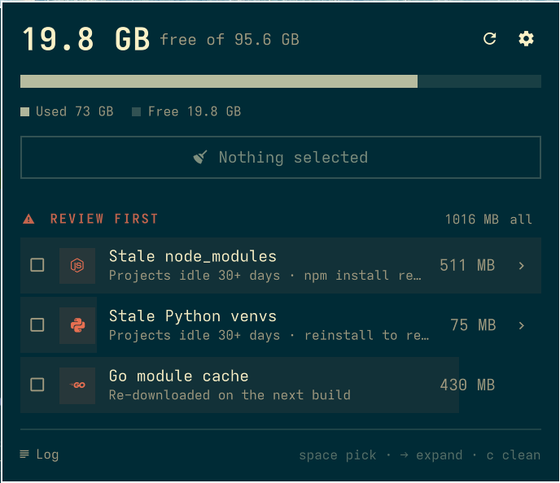

# Disk Space

Free disk space safely on Omarchy: see what's taking room, pick what goes, and clean it
from one panel in your bar.



## Features

- **Free space in the bar**: `󰋊 19.8G` next to your other widgets. It turns red, and you get
  one notification, when free space drops below a limit you set.
- **Usage bar**: used space, what you've selected to free, and free space, side by side.
- **Safe to clean**, ticked by default. These are caches that rebuild themselves:
  - npm, pnpm, Bun, uv, pip and Go build caches, cleaned with each tool's own command
  - unused mise tool versions (`mise prune`)
  - AUR build folders (yay / paru) and thumbnails
  - browser caches, skipping any browser that is open
  - old Playwright browser builds and old Codex releases
  - Trash items older than *stale days*
  - stale build output (`.next`, `.nuxt`, `.svelte-kit`, `.turbo`, `.parcel-cache`, `.angular`,
    Rust/Maven `target`, Gradle `build`)
- **Review first**, never ticked by default. These need a reinstall afterwards or can't be undone:
  - stale `node_modules`, stale Python venvs
  - everything in the Trash
  - the Go module cache
- **Pick folder by folder**: expand a target to see each folder or file with its size and how
  long the project has been idle. Tick only what you want, **open** it in your file manager first,
  or **ignore** a project so it's never suggested again.
- **System cleanup**: a guided terminal walkthrough for the parts that need `sudo`. Each step
  asks first, and you can skip any of them:
  - crash dumps and the journal
  - the pacman cache and orphaned packages
  - Docker dangling images and build cache
  - btrfs snapshots and a balance, so freed space can be reused
- **Progress and proof**: the panel shows the target being cleaned, then the space actually
  freed. Every deletion is written to a log you can open from the panel.
- **Keyboard**: `↑/↓` move, `space` tick, `→/←` expand or collapse, `o` open, `i` ignore,
  `c` clean, `r` rescan, `s` system cleanup, `esc` close.

## Safety

This plugin deletes files, so it's built to be conservative:

- Only the targets listed above are ever touched. Nothing is deleted by searching the disk
  for a pattern.
- The panel only names targets and folders. `bin/space-clean` finds every path itself right
  before deleting. A folder it didn't find on its own is ignored, so the panel can narrow
  the list but never add to it.
- Every path must resolve inside `$HOME`, at least two levels deep, and must not be a
  symlink. Removal uses `rm --one-file-system`, so links are removed and never followed.
- A project's build files only count as stale when **all** of these are true:
  - nothing in the project (or its enclosing git repo) has changed for *stale days*, including `.git/index`
  - no process is running inside it
  - its manifest is present: `package.json` plus a lockfile for `node_modules`, a `pyproject.toml` / `requirements*.txt` / … for venvs, `Cargo.toml` / `pom.xml` for `target`
- The project scan never goes into hidden folders, so tools installed under `~/.local` and
  similar are never touched.
- Nothing runs as root from the panel. `sudo` is only used in the terminal walkthrough.

## Install

```bash
omarchy plugin add https://github.com/zaki2993/zakarch.space --enable
```

## Remove

```bash
omarchy plugin remove zakarch.space
```

## Settings

Set these on the `zakarch.space` bar entry in `~/.config/omarchy/shell.json`, or in the bar settings UI:

| Key | Default | Meaning |
|---|---|---|
| `showFreeSpace` | `"On"` | show free GB next to the icon |
| `warnFreeGB` | `10` | below this the icon turns red and you get one notification |
| `staleDays` | `30` | how long a project must be untouched (min 7) |
| `scanRoots` | `"~"` | colon-separated folders to search for project build files |

## Command line

The panel is a front end for `bin/space-clean`, which also works on its own:

```bash
S=~/.config/omarchy/plugins/zakarch.space/bin/space-clean
$S scan                                      # sizes of every target (read-only)
$S clean --dry-run npm uv                    # show what would be removed
$S clean npm uv build-caches                 # clean whole targets
$S clean stale-deps=$HOME/old/app/node_modules   # one folder of a target
$S ignore ~/projects/keep-me                 # never suggest it again (unignore PATH|--all)
$S system                                    # the sudo walkthrough, in this terminal
```

## Files

- `Panel.qml`: bar icon and panel
- `bin/space-clean`: scanning, path checks and cleaning (bash, needs `jq` and `gum`, both shipped with Omarchy)
- Log: `~/.local/state/space-clean/clean.log`
- Ignored projects: `~/.config/space-clean/ignore`
